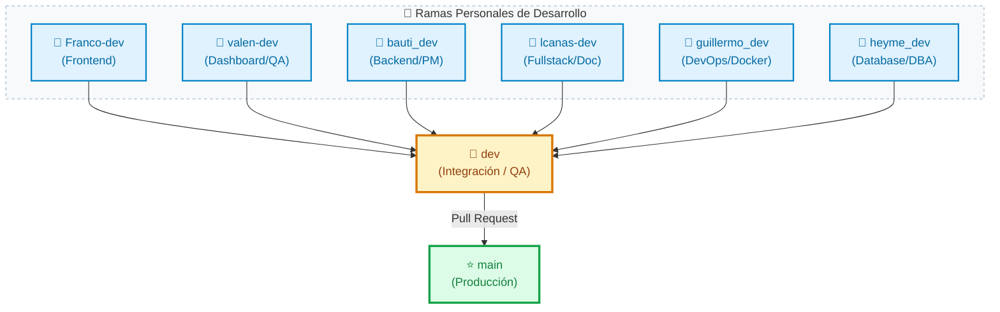

## 🚀 Guía de Ejecución Local y Acceso a la Plataforma
### Cabe destacar que esto es para poder levantar el Frontend.
El backend necesita de otro comando, otras dependencias pero que no se va a poder ejecutar ya que se necesita el acceso a la base de datos hosteada.

### 1. Clonar el repositorio y sincronizar la rama `dev`
```bash
# 1. Clonar el proyecto
git clone [https://github.com/16th-Tech-Industry/web-vidriera-productiva.git](https://github.com/16th-Tech-Industry/web-vidriera-productiva.git)

# 2. Entrar al directorio
cd web-vidriera-productiva

# 3. Posicionarse en la rama de desarrollo
git checkout dev

# 4. Traer las últimas actualizaciones
git pull origin dev
```

### 2. Instalar dependencias y levantar el servidor local
```bash
# Instalar los paquetes necesarios
npm install

# Iniciar el servidor de desarrollo
npm run dev
```

Una vez iniciado el servicio, abre tu navegador web e ingresa a:  
👉 `http://localhost:5173` *(o la URL local que indique la consola)*.

---

### 🔑 Acceso al Dashboard de Administración

Al ingresar se mostrará la pantalla de **Login**. Para acceder con permisos administrativos al panel de gestión, utiliza las siguientes credenciales de prueba:

* **Email:** `admin@admin.com`
* **Password:** `Admin987654`

usuario:
* **Email:** `francoavila935@gmail.com`
* **Password:** `Francolat22`


> ⚠️ **Nota:** Estas credenciales son de uso provisorio y exclusivo para el entorno de desarrollo y testing local.

---
# En esta entrega todos los cambios de código y vistas en general se encuentran en la rama "dev" ya que aún no se encuentran en estado de pasar a la rama "main"

# 🌾 Córdoba Vidriera Productiva — Digitalización y Gestión Integral

[](https://fastapi.tiangolo.com/)
[](https://reactjs.org/)
[](https://www.oracle.com/database/)
[](https://www.docker.com/)
[](https://www.python.org/)

Aplicación web integral diseñada para la modernización, automatización y centralización del programa provincial **“Córdoba Vidriera Productiva”**, impulsado por el **Ministerio de Bioagroindustria** en conjunto con el **Ministerio de Producción, Ciencia e Innovación Tecnológica** de la Provincia de Córdoba.

---

## 📌 Descripción del Proyecto

El sistema sustituye los procesos manuales y descentralizados (Google Forms / Sheets) por una plataforma web automatizada de alto rendimiento que administra todo el ciclo de vida de los expositores (PyMEs agroalimentarias y agroindustriales).

### 🚀 Módulos Principales
1. **Autogestión del Productor / Expositor:**
   - Registro de nexo y autenticación de usuarios.
   - Carga dinámica del perfil de la PyME, catálogo de productos, puntos de venta y redes.
   - Repositorio de activos digitales (subida de logotipos editables y galería fotográfica de 1 a 5 imágenes).
   - Aceptación digital obligatoria del *Manual del Expositor 2026*.
   - Sistema ágil de reempadronamiento anual de datos.
2. **Dashboard de Gestión Administrativa (Ministerio):**
   - Panel de control de estados: *Nuevos, Pendientes de Validación, Registrados y Rechazados*.
   - Previsualización y validación humana de documentación y activos.
   - Filtrado avanzado por geolocalización (departamentos) y rubros para organización de ferias.
   - Automatización del envío de correos electrónicos con resoluciones de estado.
   - Exportación de listados de expositores en tiempo real.
3. **Expositor Digital (Consulta Pública y Ciudadana):**
   - Mapa interactivo provincial dividido por departamentos con renderizado rápido.
   - Fichas interactivas de oferta productiva y visualización pública del catálogo regional.

---

## 🛠️ Stack Tecnológico

| Capa | Tecnología | Descripción |
| :--- | :--- | :--- |
| **Frontend** | **React (SPA)** | Arquitectura modular basada en componentes, Virtual DOM y navegación fluida sin recargas. |
| **Backend** | **FastAPI (Python)** | Framework asíncrono de alto rendimiento, comunicación en tiempo real con WebSockets y documentación OpenAPI/Swagger. |
| **Base de Datos** | **Oracle Database** | Motor relacional robusto para garantizar integridad, seguridad y disponibilidad de datos gubernamentales. |
| **DevOps / Despliegue** | **Docker & Docker Compose** | Empaquetado en contenedores y despliegue modular/monolítico adaptado a la infraestructura ministerial. |

---

## 🌿 Flujo y Sistema de Ramas (Git Branching)



### Descripción Detallada del Sistema de Ramas

#### 1. ⭐ `main` (Rama Principal)
*   **Propósito:** Contiene el código de producción completamente estable, revisado y listo para lanzamiento.
*   **Regla:** Es una rama protegida. No se permite realizar `commits` directos.
*   **Integración:** Solo recibe código de la rama `dev` a través de un Pull Request (PR) aprobado por el equipo, tras verificar que todos los tests pasen.

#### 2. 🚀 `dev` (Rama de Integración y Desarrollo Central)
*   **Propósito:** Punto de convergencia de todas las ramas personales para pruebas de integración y QA.
*   **Regla:** Es la rama central de trabajo colaborativo.
*   **Integración:** Recibe los cambios de los desarrolladores individuales a través de PRs.

#### 3. 👥 Ramas Personales de Desarrollo
*   **Propósito:** Trabajo aislado de cada desarrollador para implementar características y tareas específicas.
*   **Regla:** El trabajo se desarrolla en la rama personal (ej. `guillermo_dev`).
*   **Integración:** Una vez finalizada la tarea, el desarrollador debe abrir un PR hacia `dev`.
*   **Ramas Personales:**
    *   **🌿 Franco-dev:** Frontend / Interfaz de Usuario (UI) con React.
    *   **🌿 valen-dev:** Dashboard de Administración y QA Testing.
    *   **🌿 bauti_dev:** Backend API con FastAPI y Gestión de Proyecto.
    *   **🌿 lcanas-dev:** Fullstack Development y Documentación Técnica (OpenAPI).
    *   **🌿 guillermo_dev:** DevOps, Dockerización de Microservicios y Cloud Infrastructure.
    *   **🌿 heyme_dev:** Database Administration (DBA), Modelado Relacional y Oracle SQL.


### 🐳 Ejecución con Docker + Oracle
Requisito: Docker Desktop

Antes de levantar: copiar `.envexample` a `.env` (en la raíz) y completar
`DB_USER`, `DB_CONNECTION`, `PASSWORD` y `JWT_SECRET_KEY`. El backend toma
esas variables del `.env`.

Para que salgan los mails (bienvenida, recupero de contraseña y aviso de
empresa aprobada o rechazada) hay que completar también `SMTP_HOST`,
`SMTP_PORT`, `SMTP_USER`, `SMTP_PASSWORD` y `FRONTEND_URL` con los datos de
una casilla de pruebas de Mailtrap. El detalle está en `backend/README.md`
("Envío de mails"). Sin esas variables la aplicación funciona igual, pero no
manda mails.

Levantar:
docker compose up --build

Accesos:
- Frontend: http://localhost:5173
- Backend: http://localhost:8000
- Oracle DB: lo realizamos utilizando una VPN que nos conecta con un servidor propio que aloja la DB


## 📄 Justificación: documentos JSON en lugar de MongoDB

Los lineamientos del ABP piden una base no relacional (MongoDB) con un uso
"justificado y documentado según la naturaleza de los datos". El proyecto
no usa MongoDB: ese lugar lo ocupan los documentos JSON de las empresas.

**Qué reemplaza a MongoDB.** Cada empresa es un documento JSON con sus
datos públicos y sus productos. Los documentos de las empresas aprobadas se
guardan en un archivo, `backend/empresas_repo/empresas.json`, que es de
donde lee la vidriera pública. El mismo documento está guardado en Oracle,
en la columna JSON nativa `empresas.datos_publico`, que funciona como
fuente de verdad y respaldo: si el archivo se pierde, se vuelve a armar
desde la tabla.

**Naturaleza de los datos.** El perfil de cada empresa es información
pública: nombre, rubro, ubicación, contacto, redes y productos. Tiene forma
de documento: campos anidados, una colección de productos embebida y una
estructura que puede variar de una empresa a otra. No guarda datos
sensibles, así que no requiere un esquema de resguardo complejo; lo que sí
requiere es estar disponible rápido, porque es lo que consulta cualquier
visitante de la vidriera.

**Por qué un documento.** La empresa y sus productos se leen siempre
juntos. Guardarlos en un único documento permite obtener la ficha completa
con una sola lectura, sin uniones entre tablas. Agregar los productos no
exigió modificar la estructura de la base: el documento admitió la clave
nueva.

**Rápida disposición.** La vidriera pública no consulta la base en cada
visita: lee el archivo JSON ya armado. En una prueba local, la consulta que
arma el archivo desde Oracle tardó 0,19 s y las siguientes, leyendo el
archivo, 0,003 s. El archivo se actualiza solo cuando un administrador
aprueba o rechaza una empresa, cuando un representante modifica sus
productos y cuando el archivo no se encuentra.

**La ventaja de Oracle como respaldo.** Oracle 21c o superior ofrece JSON
nativo, consultable e indexable. Esto permite un modelo híbrido: relacional
para usuarios y geografía, donde hay relaciones e integridad que cuidar, y
documental para el perfil de la empresa. Al quedar guardado dentro de
Oracle, el documento hereda sin infraestructura adicional sus garantías:
transacciones, respaldo junto al resto de los datos e integridad
referencial con el representante dueño de la empresa. Los filtros del panel
de administración (rubro, zona y departamento) usan índices sobre campos
internos del documento.

**Validación.** La forma del documento se valida en el backend antes de
guardar. Oracle permite además validarla en la propia base con un esquema
JSON (`IS JSON VALIDATE`), que rechaza documentos incompletos o con valores
fuera de rango. Probado con consultas de solo lectura contra el servidor
del proyecto (Oracle 23.26 Free):

| Documento | Resultado |
| :--- | :--- |
| Empresa completa con un producto | Válido |
| Sin `correo_empresa` | Rechazado |
| Latitud fuera de rango (120) | Rechazado |
| Producto sin `nombre` | Rechazado |

La restricción todavía no está aplicada a la tabla: la empresa de prueba
cargada a mano (id 1) no cumple el esquema y hay que corregirla antes.

**Por qué no un segundo motor.** No se espera una cantidad de empresas que
haga crecer demasiado los documentos ni el conjunto de datos, y la carga
prevista no alcanza para justificar una base de datos dedicada solo a
ellos. Sumar MongoDB implicaría:

- otra base, otro contenedor y otro servicio que desplegar;
- una librería más en el backend de Python (el conector de MongoDB), con su
  configuración y mantenimiento;
- más consumo en el hosting: un segundo servicio con su propio
  almacenamiento, cuando los planes disponibles ya son limitados, sin que
  eso ayude a guardar mejor los datos. El archivo JSON, en cambio, no
  necesita almacenamiento persistente: si el disco del hosting se reinicia,
  se regenera desde Oracle;
- mantener sincronizadas dos bases distintas.

Incorporarlo en la última entrega habría puesto en riesgo la estabilidad de
funcionalidades ya probadas, sin una mejora medible.

**Estructura de los documentos.** El esquema completo, con sus reglas por
campo, está en `backend/README.md` (secciones de productos y de la vidriera
pública) y en `db/README.md`, con un ejemplo en `db/empresas.json`.
